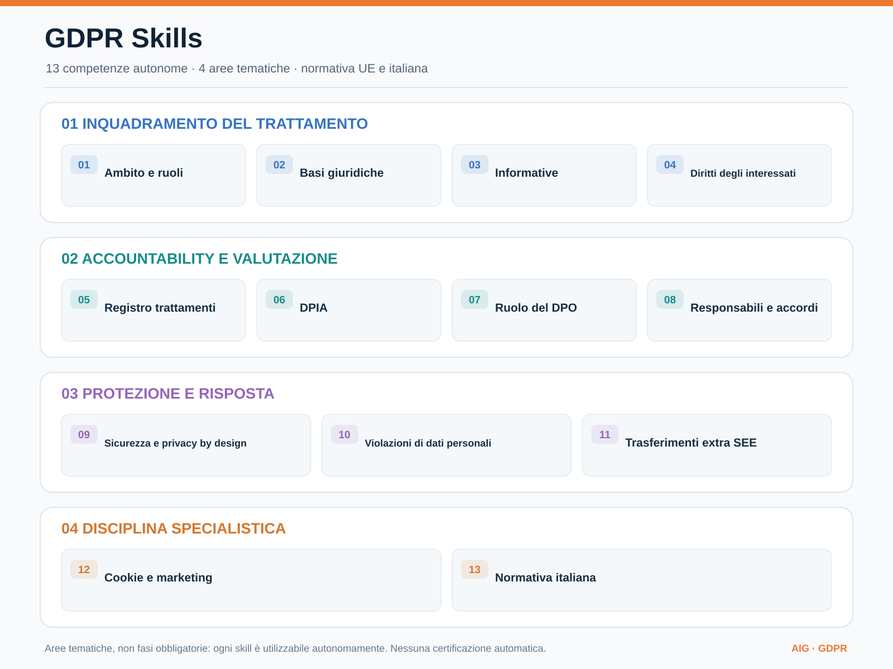

# GDPR Skills

Catalogo di 13 skill autonome per analisi documentale e normativa GDPR, con disciplina UE e italiana.

**Stato:** prima versione operativa documentale, non validazione giuridica né certificazione di conformità. Ogni skill può essere invocata indipendentemente.

## Skill disponibili

[Apri il diagramma vettoriale SVG](assets/gdpr-competencies.svg)

La mappa organizza **13 competenze autonome in quattro aree tematiche**: non rappresenta un workflow obbligatorio né una sequenza di adempimenti.

| Skill | Competenza |
| --- | --- |
| [`gdpr-scope-roles`](gdpr-scope-roles/SKILL.md) | Ambito e ruoli GDPR |
| [`gdpr-lawful-basis`](gdpr-lawful-basis/SKILL.md) | Basi giuridiche |
| [`gdpr-notices`](gdpr-notices/SKILL.md) | Informative e trasparenza |
| [`gdpr-data-subject-rights`](gdpr-data-subject-rights/SKILL.md) | Diritti degli interessati |
| [`gdpr-ropa`](gdpr-ropa/SKILL.md) | Registro delle attività di trattamento |
| [`gdpr-dpia`](gdpr-dpia/SKILL.md) | Valutazione d'impatto DPIA |
| [`gdpr-dpo`](gdpr-dpo/SKILL.md) | Responsabile protezione dati DPO |
| [`gdpr-processors`](gdpr-processors/SKILL.md) | Accordi e sub-responsabili |
| [`gdpr-security`](gdpr-security/SKILL.md) | Sicurezza e privacy by design |
| [`gdpr-breach`](gdpr-breach/SKILL.md) | Violazioni dati personali |
| [`gdpr-international-transfers`](gdpr-international-transfers/SKILL.md) | Trasferimenti extra SEE |
| [`gdpr-cookies-marketing`](gdpr-cookies-marketing/SKILL.md) | Cookie e marketing digitale |
| [`gdpr-italy`](gdpr-italy/SKILL.md) | Disciplina italiana sulla protezione dati |

## Principi

1. Verificare sempre testo vigente, versione, data di applicazione, eventuali eccezioni e giurisdizione.
2. Citare fonti primarie, articoli, URL, data di consultazione e fatti probatori; non inventare citazioni.
3. Separare fatto verificato, dichiarazione del richiedente, ipotesi, lacuna, proposta e decisione autorizzata.
4. Non dichiarare conformità giuridica; richiedere valutazione professionale quando necessaria.
5. Nessun invio, notifica, accettazione, pubblicazione o modifica operativa senza esplicita autorizzazione.
6. La normativa italiana integra/specífica i regolamenti UE direttamente applicabili: non chiamarla trasposizione generalizzata.

## Fonti primarie

- [GDPR, EUR-Lex](https://eur-lex.europa.eu/eli/reg/2016/679/oj)
- [Codice privacy vigente, Normattiva](https://www.normattiva.it/eli/id/2003/07/29/003G0218/CONSOLIDATED)
- [D.Lgs. 101/2018, Normattiva](https://www.normattiva.it/eli/id/2018/09/04/18G00129/CONSOLIDATED)
- [Garante per la protezione dei dati personali](https://www.garanteprivacy.it/)

## Utilizzo

Ogni cartella contiene `SKILL.md` in formato Agent Skills. Copiare la singola cartella nella directory skill del proprio client (es. `~/.claude/skills/`, `~/.config/opencode/skills/`, `.agents/skills/`). Le skill guidano la produzione di documenti: non eseguono azioni verso autorità o terzi.

## Progetto e limiti

La [scheda obiettivo](https://github.com/aigconsulting/GDPR-skills/issues/1) documenta perimetro e criteri di accettazione. Sono ancora da implementare test automatici, un catalogo HTTP/versionato, casi di prova E2E, integrazioni applicative e review giuridica. La presenza del file SKILL.md non certifica il risultato prodotto da un agente.
